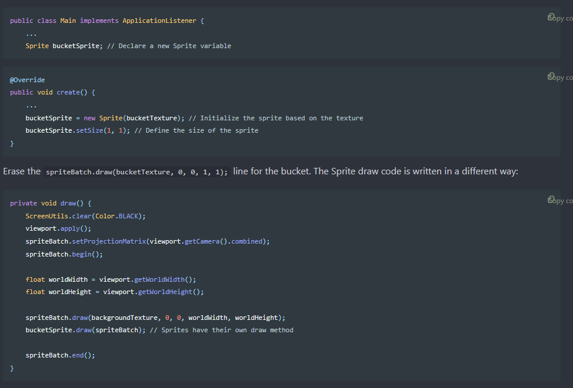

# Tool Learning Log

## Tool: **LibGDX**

## Project: **MotoX3M Type Game**

---

### 10/19/26:
* I didnt get to do too much, but I explored the showcase and played a few games. I got addicted to one of them so im hoping that this will be a succesful project
* They have a great starting [tutorial](https://libgdx.com/wiki/start/a-simple-game). I think its simalair to PhaserJS, so it won't be a complete nightmare to figure out
* There are some good tutorials for what I may need, including: [this platformer video](https://www.youtube.com/watch?v=43DrvCp9-is) and some longer ones, like [this](https://www.youtube.com/watch?v=3BC8E6SbveM).
* Some of the starter code includes things we haven't quite learned about yet
``` bash
 private void logic() {
        float worldWidth = viewport.getWorldWidth();
        float worldHeight = viewport.getWorldHeight();
        float bucketWidth = bucketSprite.getWidth();
        float bucketHeight = bucketSprite.getHeight();

```
This includes a few of the constructors that make all kinds of various functions.
My plan for the next week  is to start working on this and do something simalair to what I did last year. I want to play around with the code they give me so I can get a better understanding of what I am doing. However I dont want to spend months on it like I did with Phaser, and I want to make sure I have enough time to work on my main project.
* 
### 11/3/26:
* This week was also slow because there was a lot of other things going on but I tried to get used to the code that libgdx uses. I use dthe same [tutorial](https://libgdx.com/wiki/start/a-simple-game) from last time but I went further with the code. I think it is similair-ish to Phaser and surprisingly P5Js but there are some differences. 
* I started off with writing the code to get used to the syntax and writing all of the methods it needs. This started off with making the textures:
``` bash
public void create() {
    backgroundTexture = new Texture("background.png");
    bucketTexture = new Texture("bucket.png");
    dropTexture = new Texture("drop.png");
}
```
This just makes some preloaded textures availible to the game. I remember this being slightly more complex in Phaser so its nice to have it in an easy to remember format. And since I am also currently learning methods and constructurs and stuff, these will get a lot easier and more comprehensible for me. 
* The P5 part isnt too long, but I noticed a similarity. The code I write here will be seperate and dedicated for certain things (this was also the case in Phaser, but I *think* that this is more specialized)
``` bash
  input();
    logic();
    draw();
```
I am not entirely sure what these do yet other than seperate code and make it neater but my hypothosis is that its for input controls, and game design stuff as stated in their names. So far it seems fairly straightforward. I haven't looked at the documentation much to see how detailed it is, but so far its a lot nice than Phaser. Next week I want to do one of the YT tutorials and dig deeper into the code. 

### 11/16/26
* Three bad weeks in a row! I think it was surprisingly productive for how little I did. I think im starting to grasp a lot of the code especially since we are learning about Classes and stuff (which are big parts of any Java library).

For example, all the code at the top of each snippet seemed very intimidating to me when I was looking at tools to use at the start of the year, but now I understand what they are and what they do. The first one creates the Main class, and attaches a "Listener" onto it for detecting inputs from the keyboard. This is what allows the inside code to attach said inputs to player movement.
* The next 2 make classes for making and rendering stuff and it just seperates out the code so that it isnt all jumbled together. 
<!-- 
* Links you used today (websites, videos, etc)
* Things you tried, progress you made, etc
* Challenges, a-ha moments, etc
* Questions you still have
* What you're going to try next
-->
